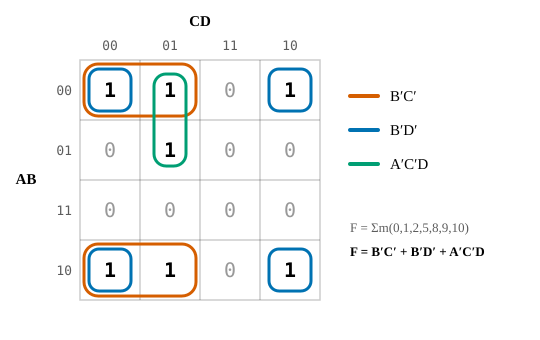

<!-- TEMPLATE: Copy this folder to start a new exploration. Delete whatever you don't need. -->

## LaTeX math

Inline $F = \bar B\bar C + \bar B\bar D$, or a numbered display equation. IEEE style refers to it as (@eq-minterms):

$$
F(A,B,C,D) = \sum m(0,1,2,5,8,9,10)
$$ {#eq-minterms}

::: {.column-margin}
A margin note: definitions, asides, or a pointer to further reading. Text that
would clutter the main column.
:::

## Figure

Reference it as @fig-kmap. Labels follow IEEE style, set site-wide in `_quarto.yml` (`crossref`).

{#fig-kmap fig-alt="Four-variable Karnaugh map with rows AB and columns CD in Gray-code order (00, 01, 11, 10). Minterms 0, 1, 2, 5, 8, 9 and 10 hold 1; the other cells hold 0. Three groups are circled: B′C′ (minterms 0, 1, 8 and 9, wrapping from the top row to the bottom row), B′D′ (the four corners: 0, 2, 8 and 10) and A′C′D (1 and 5). Beside the map: F = Σm(0,1,2,5,8,9,10) = B′C′ + B′D′ + A′C′D."}

### Table

Tables are numbered with Roman numerals, captioned above; see @tbl-groups.

| Group | Minterms | Term |
|---|---|---|
| Rows 00 and 10 | 0, 1, 8, 9 | $\bar B\bar C$ |
| Corners | 0, 2, 8, 10 | $\bar B\bar D$ |

: Example table caption. {#tbl-groups}

## WaveDrom timing diagram

Diagrams are figures too; wrap them in a `#fig-` div to number and caption them (@fig-timing).

::: {#fig-timing}
```{=html}
<div class="wavedrom-wrap" role="img" aria-label="Timing diagram of signals CLK, D, Q and Q-bar over seven rising clock edges. D goes high before the second edge, low before the fourth, pulses high briefly between the fourth and fifth edges, goes high before the sixth and low before the seventh. Q is unknown until the first edge, then takes D's value at each rising edge: 0, 1, 1, 0, 0, 1, 0, so the brief pulse never reaches Q. Q-bar is always the opposite of Q.">
<script type="WaveDrom">
{ signal: [
  { name: "CLK", wave: "lP......", period: 2 },
  { name: "D",   wave: "0.....1.......0...10..1...0.....", period: 0.5 },
  {},
  { name: "Q",   wave: "x...0...1.......0.......1...0...", period: 0.5, phase: -0.5 },
  { name: "Q̅",   wave: "x...1...0.......1.......0...1...", period: 0.5, phase: -0.5 }
]}
</script>
</div>
```

Positive-edge-triggered D flip-flop. Q takes the value of D at each rising CLK edge (arrows); the pulse on D between edges is ignored.
:::

## DigitalJS circuit

Circuit JSON lives next to this file (`circuit.json`). Click the inputs to toggle them (@fig-circuit).

::: {#fig-circuit}
::: {.digitaljs-paper data-circuit="circuit.json" role="group" aria-label="Interactive circuit: input buttons A and B feed a two-input AND gate whose output drives lamp Y. Clicking a button toggles that input."}
:::

Interactive circuit caption.
:::

## Citations

Cite with `[@karnaugh1953]` from `references.bib`, which renders in IEEE numeric style [@karnaugh1953]. The list renders below.

## References {.unnumbered}

::: {#refs}
:::
